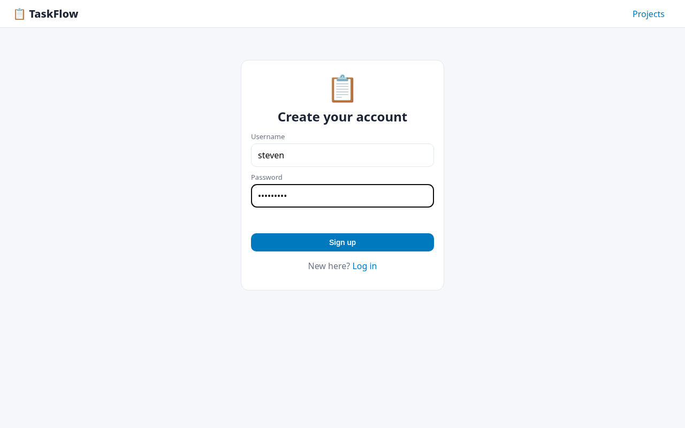
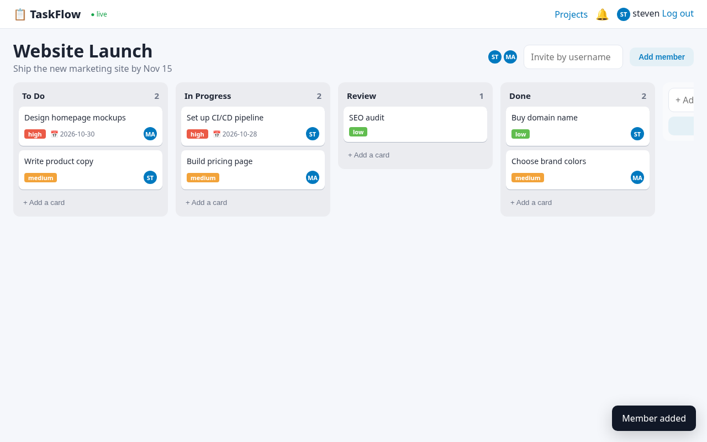
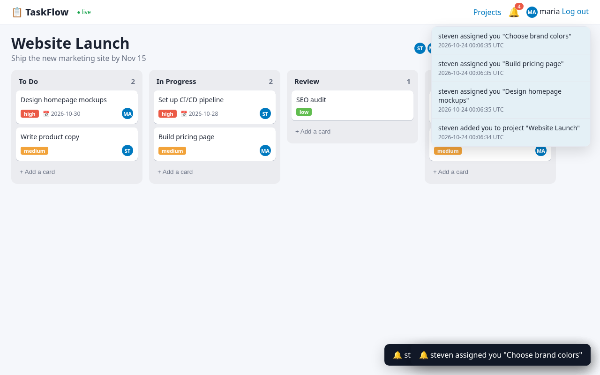
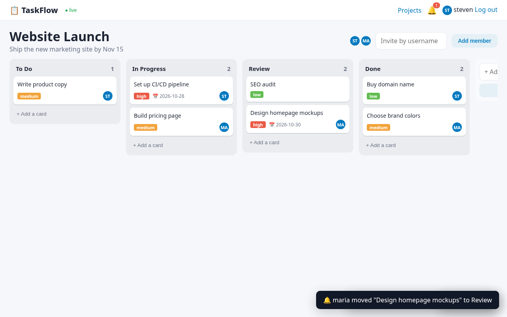
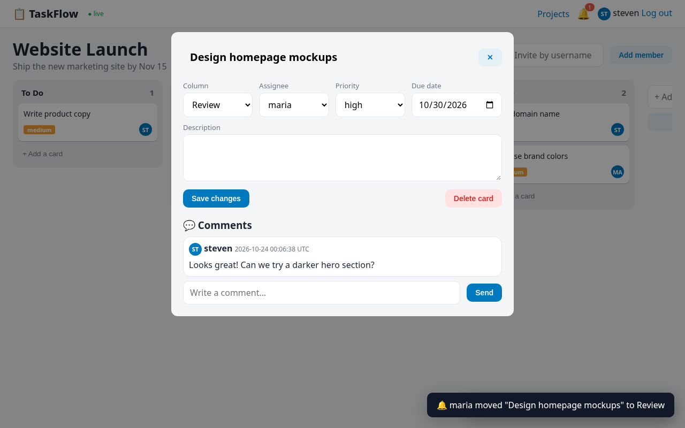
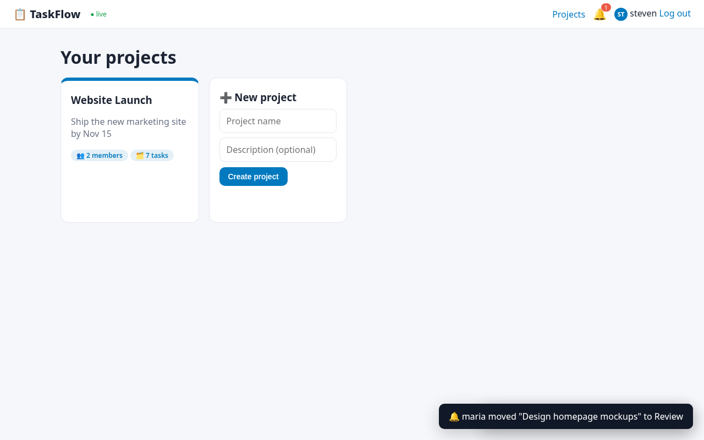

# TaskFlow — Project Management Tool

CodeAlpha Full Stack Development Internship — **Task 3: Project Management Tool**


## Features

- Accounts with bcrypt + JWT
- Create projects and invite team members by username
- Kanban boards (To Do / In Progress / Review / Done, plus custom columns)
- Tasks with description, assignee, priority and due date; drag & drop between columns
- Comments on tasks
- **Real-time updates** with Socket.IO (JWT-authenticated sockets) — every member sees cards move, appear and change instantly
- In-app notifications (bell + toasts) for assignments, invitations, moves and comments
- Access control: only project members can read or modify a board

## Tech stack

- **Backend:** Node.js 20+, Express 5, SQLite (better-sqlite3), Socket.IO
- **Auth:** bcrypt password hashing (bcryptjs) + JSON Web Tokens
- **Frontend:** vanilla HTML, CSS and JavaScript (single-page app, no framework)
- **Tests:** Node's built-in test runner + Supertest — 11 tests, run on GitHub Actions (Node 20 & 22)

## Getting started

```bash
git clone https://github.com/x3r01432/CodeAlpha_ProjectManagementTool.git
cd CodeAlpha_ProjectManagementTool
npm install
npm start
```

Open <http://localhost:3000>. The SQLite database (`projects.db`) is created automatically on first run.

Configuration (optional environment variables): `PORT` (default 3000), `JWT_SECRET` (set this in production — otherwise a random secret is generated on each start), `DB_FILE`.

```bash
npm test
```

## API overview

- `POST /api/auth/register`, `POST /api/auth/login`
- `GET/POST /api/projects`, `GET /api/projects/:id`, `POST /api/projects/:id/members`, `POST /api/projects/:id/columns`
- `POST /api/projects/:id/tasks`, `PATCH/DELETE /api/tasks/:id`, `GET/POST /api/tasks/:id/comments`
- `GET /api/notifications`, `POST /api/notifications/read`
- Socket.IO: `project:join`, `board:event`, `notification`

## Screenshots

**Signup**



**Board**



**Notifications maria**



**Realtime move seen by steven**



**Task details comments**



**Comment notification maria**


**Projects**



## Author

**Steven Manuel Rios** ([@x3r01432](https://github.com/x3r01432)) — built for the CodeAlpha Full Stack Development internship.

## License

[MIT](LICENSE) © 2026 Steven Rios
